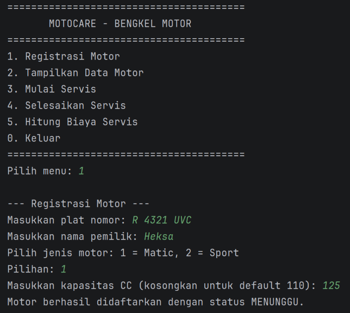
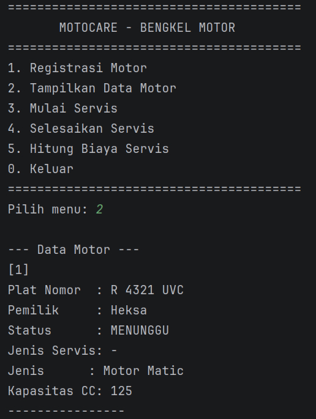
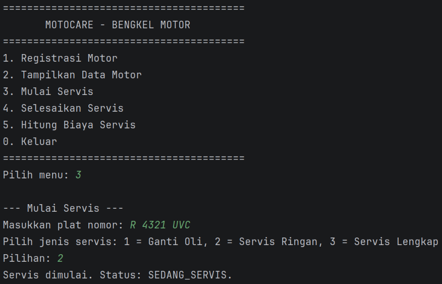
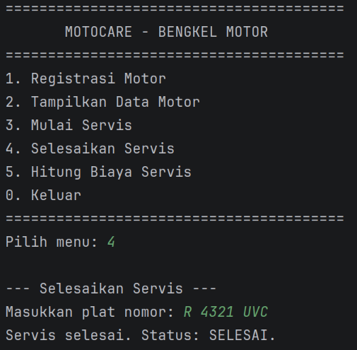
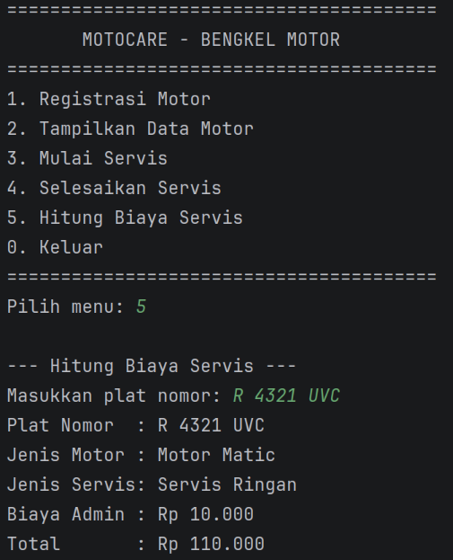
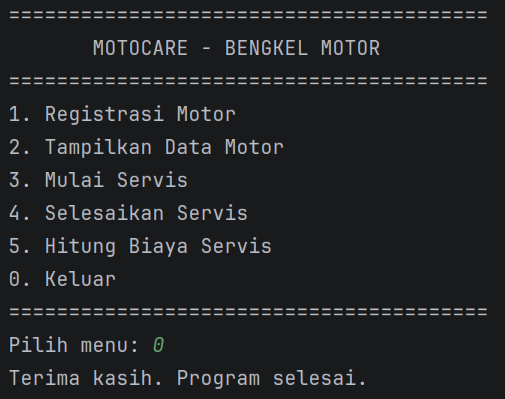

# Sistem Bengkel Motor - Sistem Manajemen Servis Bengkel Motor

Program sederhana untuk membantu bengkel motor mengelola data motor pelanggan dan proses servisnya. Program ini dibuat sebagai penilaian responsi Praktikum Pemrograman Berorientasi Objek (PBO).

## Identitas Mahasiswa
- Nama : Heksa Aji Permana
- NIM : H1D025098
- Program Studi : Informatika
- Universitas : Universitas Jenderal Soedirman
- Tema : Otomotif

## Fitur Utama
1. Registrasi Motor (Matic / Sport)
2. Tampilkan Data Motor
3. Mulai Servis
4. Selesaikan Servis
5. Hitung Biaya Servis
0. Keluar

## Batasan
- Data disimpan hanya dalam `ArrayList<Kendaraan>` selama program berjalan (tidak ada file persistence / database).
- Status `SELESAI` bersifat final: motor tidak dapat diservis ulang.
- Biaya hanya boleh dihitung setelah status `SELESAI`.
- Tidak ada GUI, login, multi-user, riwayat servis, atau servis ulang.

## Struktur File
```
Sistem Bengkel Motor/
├── StatusServis.java       - enum status servis
├── JenisServis.java        - enum jenis servis + harga
├── DapatDiservis.java      - interface mulai/selesai servis
├── DapatDihitungBiaya.java - interface hitung biaya servis
├── Kendaraan.java          - abstract class induk
├── MotorMatic.java         - subclass Motor Matic
├── MotorSport.java         - subclass Motor Sport
├── Main.java               - menu interaktif + main
├── README.md
```

## Tabel Pemetaan 10 Requirement PBO

| # | Requirement | Lokasi Implementasi |
|---|-------------|---------------------|
| 1 | State dan behavior | `Kendaraan` (atribut, `tampilkanInfo`, `hitungBiaya`) |
| 2 | Immutability | `BIAYA_ADMIN` (`public static final`), `platNomor` (`private final`, tanpa setter) |
| 3 | Encapsulation dan overloading | Atribut private, getter/setter, `this`, dua constructor di `MotorMatic`/`MotorSport` |
| 4 | Inheritance | `MotorMatic` dan `MotorSport extends Kendaraan` |
| 5 | Super chaining | `super(plat, pemilik)`, `super.tampilkanInfo()` |
| 6 | Overriding | `@Override` pada `tampilkanInfo`, `ubahStatus`, `hitungBiaya` |
| 7 | Abstract class | `abstract class Kendaraan` dengan method abstract `ubahStatus` dan `hitungBiaya` |
| 8 | State branching | if/else-if di `ubahStatus()` tiap subclass |
| 9 | Polymorphism interface | `DapatDiservis s = ...` |
| 10 | Multiple interface | `implements DapatDiservis, DapatDihitungBiaya` pada kedua subclass |

## Cara Compile dan Run
Pastikan Java 8 atau lebih baru terinstal. Buka terminal di folder proyek lalu jalankan:

```text
javac *.java
java Main
```

Jika perintah `javac` tidak ditemukan (tidak ada di PATH), cari lokasi JDK terlebih dahulu:

```text
ls /usr/lib/jvm/java-*/bin/javac
```

Lalu gunakan path lengkapnya, contoh:

```text
/usr/lib/jvm/java-21-openjdk/bin/javac *.java
java Main
```

## Output Program (Hasil Ulangi)
Berikut adalah output asli dari program saat dijalankan melalui terminal. Setiap menu ditampilkan sebagai screenshot tersimpan di folder `screenshots/`:

1. **Menu utama dan Registrasi Motor (menu 1)**  
   

2. **Tampilkan Data Motor (menu 2)**  
   

3. **Mulai Servis (menu 3)**  
   

4. **Selesaikan Servis (menu 4)**  
   

5. **Hitung Biaya Servis (menu 5)**  
   

6. **Keluar (menu 0)**  
   
